# Las pantallas

Las 24 están dibujadas con código propio (`tools/pantallas.py` para MSX1,
`tools/pantallas2.py` para MSX2) siguiendo los pasos de la rutina que las
pinta, citada en cada una. Ninguna es una captura. Cada una se compara byte a
byte (`tools/coteja.py`, `tools/coteja2.py`) con el cartucho ejecutado en un Z80
de Python o con la VRAM de openMSX, y todas coinciden enteras. En MSX1, las
letras de la BIOS son las de la C-BIOS japonesa.

## La presentación

El logo de Konami (`p09:8135`), al acabar su animación: una línea cada cuadro,
seis filas de 21 letras.

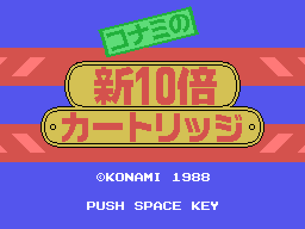

El rótulo «Konami no Shin 10-bai Cartridge», esperando el espacio
(`p09:8846`). Solo sale con una BIOS japonesa.

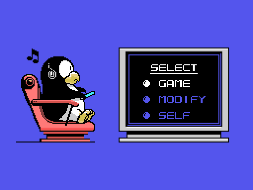

El menú principal (`p09:82CA`): GAME, MODIFY y SELF. GAME y MODIFY necesitan un
juego al lado.

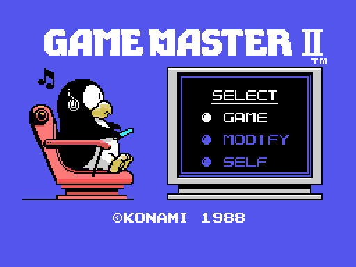

Con una BIOS no japonesa no hay rótulo, y el menú lleva «GAME MASTER II» y la
fecha (`p09:8D27`).

## El cartucho solo

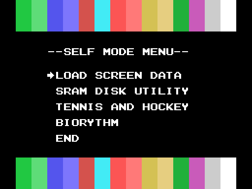

El SELF MODE MENU (`p00:5DEE`), con las casillas de los 16 colores arriba y
abajo.

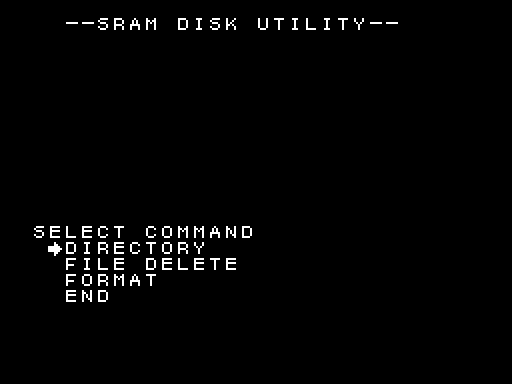

SRAM DISK UTILITY (`p01:7973`), con la fuente de la BIOS.

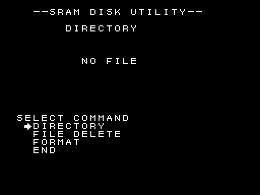
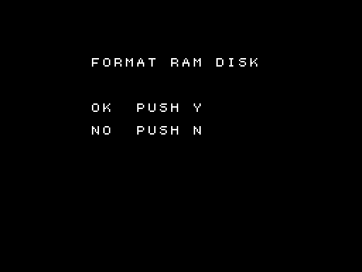
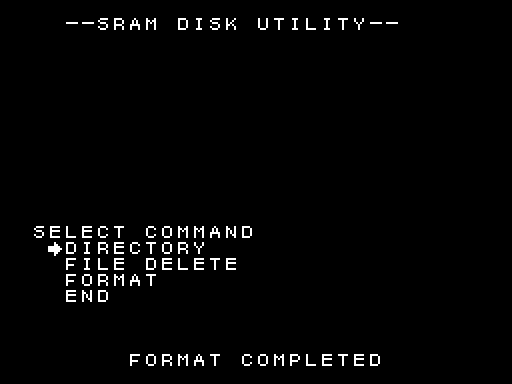
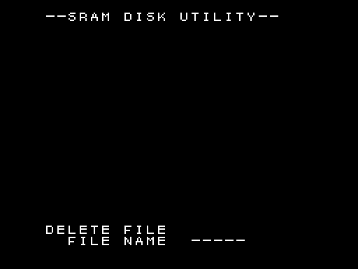

DIRECTORY con la SRAM sin formatear (`p00:417D`), la pregunta de FORMAT
(`p00:4333`), su resultado y FILE DELETE pidiendo el nombre (`p00:4209`).

## Tennis and Hockey

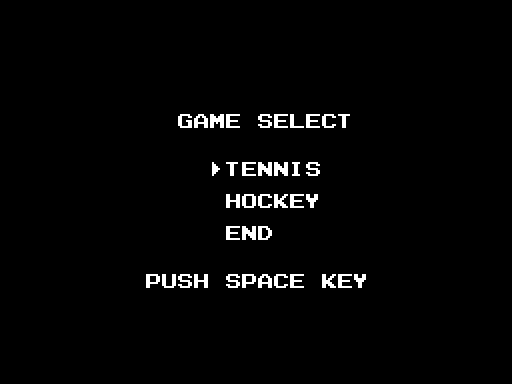
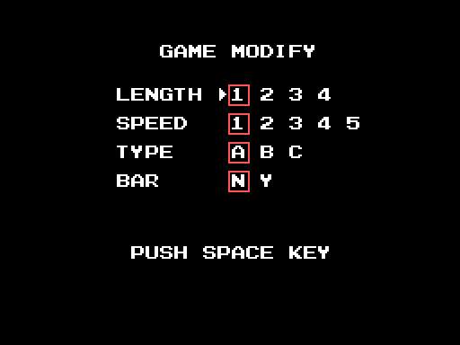

GAME SELECT (`p07:909A`) y GAME MODIFY (`p07:9100`); los recuadros rojos son
sprites.

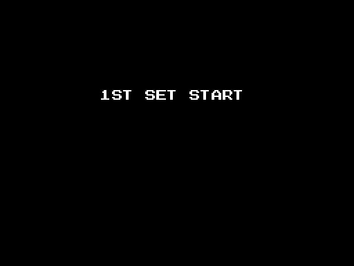
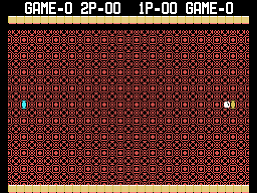

«1ST SET START» (`p07:8141`) y la pista de tenis lista para sacar
(`p07:81A2`).

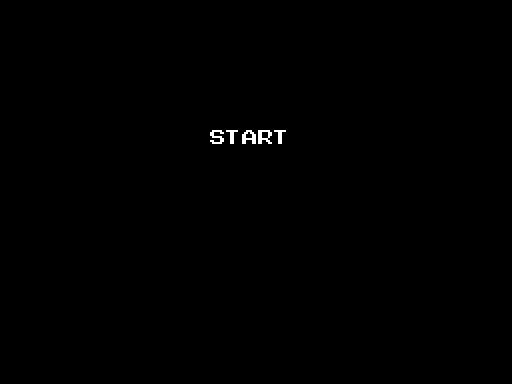
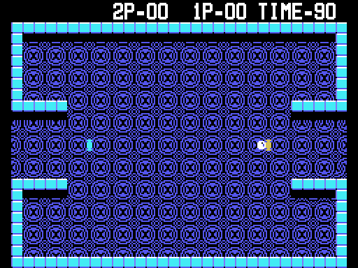

Lo mismo en el hockey, con el reloj en 90.

## El biorritmo

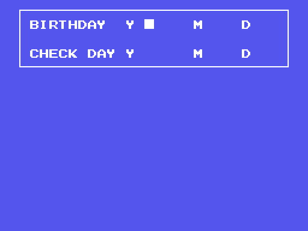
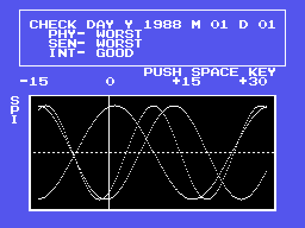

En MSX1, pidiendo las fechas (`p05:9674`) y la gráfica con las fechas de
ejemplo 1970-01-01 y 1988-01-01.

## En MSX2

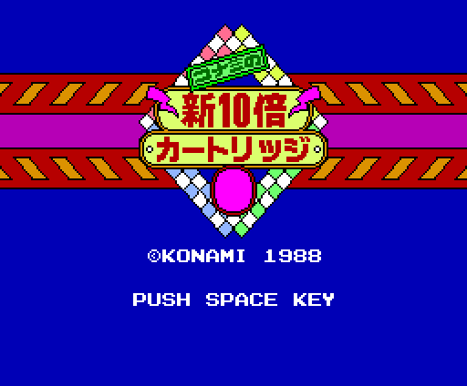
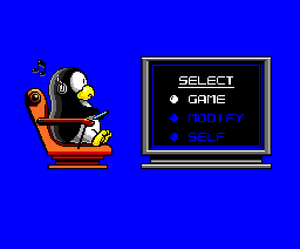
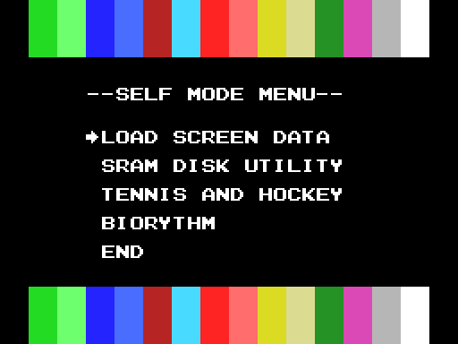
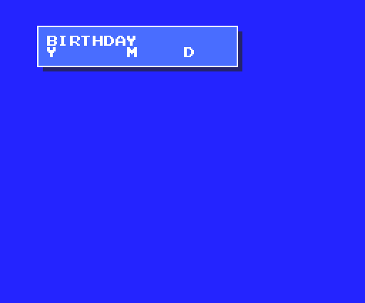
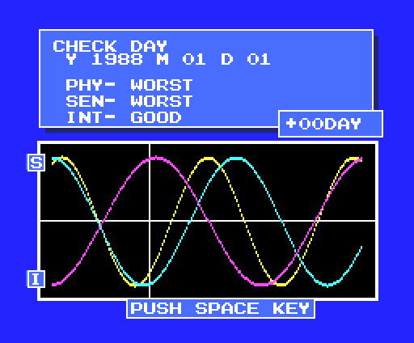

En un MSX2 con BIOS japonesa la presentación es otra: SCREEN 5, con los
dibujos montados a base de comandos del VDP (`p09:80DC`, `p09:8B20`,
`p09:8692`). El menú SELF es el mismo con la paleta del MSX2, y el biorritmo
cambia entero (`p05:8D22`, `p06:A006`).
